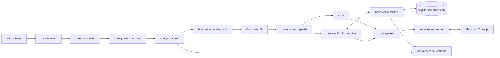
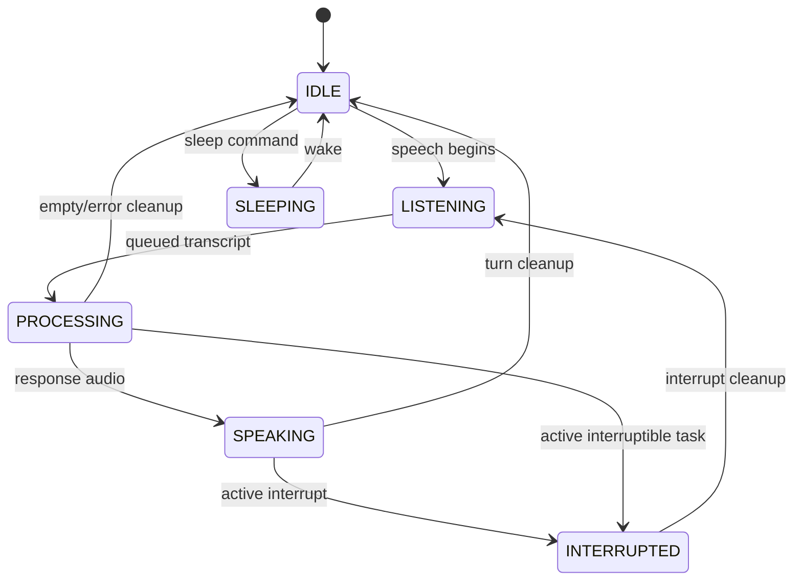

# MayaVE VE11 — Architecture Reference

**Scope and evidence.** This reference covers the main MayaVE desktop application, not AutoPhage/MACRO internals. It describes inspected source and configuration only; no runtime, model, microphone, external MayaNode, or test execution occurred for this revision. Runtime-dependent behavior is marked unverified. Source wins if documents conflict.

See [CONTRIBUTING.md](CONTRIBUTING.md) for workflow, [PROTOCOL_CONTRACT.md](PROTOCOL_CONTRACT.md) for the MayaVE–MayaNode protocol, [CHANGELOG.md](CHANGELOG.md) for issues/history, and [README.md](../README.md) for setup.

## 1. Architecture overview

MayaVE is a local-first, Windows-oriented voice assistant with a Python 3.11+ asyncio backend and Electron/Vite/Three.js VRM frontend. The backend owns capture, recognition, turn processing, routing, skills, conversation/memory, model clients, speech output, and WebSocket transport. The renderer owns avatar display and audio playback. Optional MayaNode integration is an HTTP client; its server is another repository.

The current style is a modular monolith plus renderer process and optional remote peer. Modules share process singletons (`config`, FSM, queue, context, WebSocket server); there is no DI container or REST API. Existing patterns include serialized ordinary turns, explicit FSM, validated `CommandIR` for hybrid skill execution, local model integrations, and best-effort isolation of sync/memory errors. These are conventions, not uniformly enforced layers.



## 2. Repository map

| Path | Responsibility |
|---|---|
| `main.py` | Bootstrap, logging, callbacks, warmups, task supervision. |
| `config/settings.py` | Dataclass defaults and shared `config`; `command_domains.json` defines command operations. |
| `core/` | Audio, wake detection, STT, speaker, FSM, queue, processor, confirmation, mood and behavior. |
| `brain/intent_engine.py` | Legacy BiLSTM/CNN classifier, guards/keywords, training artifacts. |
| `brain/router/` | Command understanding/IR, registry, entities, validation, retrieval, dispatch, fallback, eval. |
| `brain/conversation.py`, `memory.py`, `vector_store.py`, `embeddings.py` | Conversation context, recent history, embedding providers and SQLite vector persistence. |
| `services/llm/` | Ollama client/streaming. `services/ws_server.py` handles avatar transport and playback transactions. |
| `services/node/` | Optional discovery, protocol, HTTP client, local outbox, identity/cursor and sync. |
| `skills/` | System, web, media and utility capabilities. `skills/base.py` registry is not used by live dispatch. |
| `frontend/electron/`, `frontend/js/`, `frontend/assets/` | Desktop window, renderer/controllers, avatar and expression assets. |
| `datasets/` | Intent taxonomy, training/evaluation inputs, staging/review scripts; model artifacts generated/ignored. |
| `scripts/`, `diag.py`, `brain/router/eval_*.py` | Model prefetch and diagnostic/evaluation tools. |
| `docs/` | Architecture, contributor instructions, protocol contract, changelog. |
| `logs/` | Runtime log and tracked historical diagnostics/evaluation artifacts. |
| `.maya/tests/`, `.maya/reports/` | Local-only tests and reports per project conventions. |

No root `AGENTS.md`, `pyproject.toml`, or `pytest.ini` was found. Python dependencies: `config/requirements.txt`; frontend dependencies: `frontend/package.json`. Current `.maya/tests/` inventory is sparse; historical reports are not current test results.

## 3. Runtime architecture

### Startup and shutdown

Static trace of `main.py`: set `HF_HUB_OFFLINE` before model imports; configure console and rotating file logging; start FSM observer, WebSocket task and Node sync task; construct `Speaker`, `Transcriber`, `Processor`; register hard-stop callback; start Ollama, embedding and Kokoro warmups; set IDLE and speak greeting; then run listener and queue worker in `asyncio.TaskGroup`. `Processor` builds hybrid understanding by default and falls back to legacy classifier if setup fails. Shutdown cancels WebSocket/Node/watchdog tasks and closes Ollama client. There is no universal resource supervisor for every native model/device resource.

### Turn lifecycle

Audio callback feeds wake detection and VAD. `main.on_speech` sends completed audio to Google STT, handles wake/sleep/barge-in, then queues non-empty text (capacity 10). `QueueManager` serially calls `Processor.handle`: PROCESSING/state/transcript, history/context update, classification, dispatch, response and cleanup. Skills return tagged text for `Speaker`; LLM streams/speaks internally and returns `ALREADY_SPOKEN`. Success/error cleanup calls `turn_lifecycle.rest()` to preserve concurrent sleep. Success records only an intent id to the Node event outbox. Queue-full input is dropped; a 15-second watchdog repairs stranded LISTENING. Skill work before interruptible speech may not be cancellable.



## 4. Components and dependency boundaries

`main.py` is the composition root but many modules also import shared singletons directly. `core.processor` coordinates brain/context/router/WS/Node event; `brain.router.dispatch` imports skills; `brain.conversation` combines policy and persistence coordination. `brain/router/understand` identifies commands but does not execute skills. These boundaries are real but not mechanically enforced. Two concrete bidirectional dependency cycles raise extraction risk: `core/speaker.py` imports `services.llm.llm_service`, while that service imports core state, mood, behavior, turn-lifecycle functions and speaker helpers; and `ContextManager` writes through `services.node.memory_producer`, while `services.node.sync_manager` calls back into `ContextManager` to apply remote memory. Moving files alone cannot remove these cycles. Before changing these boundaries, define stable interfaces and ownership, then add focused regression tests for speech lifecycle/cancellation, outbox production, remote merge and cursor behavior.

| Owner | Responsibility | Dependencies / leakage |
|---|---|---|
| `core` | Capture, FSM, queue, turn orchestration, speech, behavior | Processor coordinates context, router and services. |
| `brain/router` | Classification bridge, IR, validation, routing | Dispatch reaches skills/LLM. |
| `brain` context/memory | Recent context, memory policy/retrieval | Direct generic vector-store dependency. |
| `skills` | Capability parsing, confirmation and side effects | OS/network/service calls. |
| `services` | Ollama, WebSocket and Node adapters | Module singletons and transport contracts. |
| `frontend` | Avatar/audio/presentation | JSON WebSocket only; no backend state access. |

## 5. End-to-end flows

**Voice/routing:** Listener VAD → Google STT → queue → Processor → `CommandUnderstander` (default) → `CommandIR` → registry validation → `Router.dispatch` → skill or conversational LLM. Hybrid stages include context rewrite/guards, legacy classifier confidence, semantic retrieval, then bounded LLM JSON fallback. Invalid/non-executable IR must not run a skill; pending confirmations resolve before ordinary routing. Setup/understanding failure falls back to `IntentEngine`. Router extractors decide readiness, while skills may parse effective text again, creating parser overlap.

**Response:** Skill tagged response → `Speaker.speak`; LLM uses Ollama stream → context package → phrase splitting/tag parsing → Kokoro synthesis → serialized presentation/playback. `ALREADY_SPOKEN` prevents duplicate speech.

**Frontend:** WS sends state, behavior, transcript, animation and correlated audio. First client becomes playback authority; UI messages broadcast. Frontend reconnects, renders avatar and sends `audio_done`/interrupt/diagnostics. Playback acknowledgements are correlated; timeout bounds acknowledgement wait after send, not the send itself. Disconnect settles pending playback.

**Memory/sync:** Recent turns are in-process. `ContextManager` applies cue-based memory policy, embeds/deduplicates, persists and retrieves semantic memories. It sends eligible explicit user-stated memories through the Node producer, while `NodeSyncManager` calls back into `ContextManager.apply_remote_memory_changes()` for inbound memory. Node sync is disabled by default; when enabled it uses durable outbox, identity and cursor, bounded batches and backoff. Per-item outcomes hold cursor advancement before a transiently failed inbound memory so it can retry on a later pass; terminal duplicate/ignored/invalid items can be passed. This guarantee is documented by the implementation and existing changelog regression-test entry, but this audit did not execute those tests or verify a live Node exchange. Remote memory is re-embedded/deduplicated; inbound events are not applied. `has_more` is not drained continuously in one iteration.

**Models:** Intent classifier loads/trains PyTorch BiLSTM and TensorFlow CNN artifacts. Hybrid semantics uses local BGE or configured Ollama embeddings. Ollama serves chat/routing. Kokoro serves TTS; `device="auto"` and fallback depend on installed runtime/device. Startup warms models. Google STT and selected web skills require network. Exact GPU placement/runtime recovery is unverified.

## 6. Database and persistence architecture

No main-app migration framework or centralized repository/session layer was found. In the inspected main-application source, the only SQLite connector/schema creation found is `brain/vector_store.py`; this is a source-audit finding, not a guarantee about dynamically loaded or external code. `SQLiteVectorStore` creates its table with `CREATE TABLE IF NOT EXISTS`; each operation opens/closes a connection, enables WAL and `synchronous=NORMAL`, and uses transaction contexts. No schema version, migration chain, declared indexes, foreign keys or embedding-model column appears in its schema. Similarity is NumPy brute force. Command index fingerprint sidecar is not schema versioning.

| Database/path | Owner/access | Tables/schema | Purpose | Migration and concerns |
|---|---|---|---|---|
| `~/Maya/Memory/semantic_memory.sqlite3` (directory from `config.context.memory_dir`) | ContextManager policy → `brain.vector_store.SQLiteVectorStore` | `memories(id, content, embedding BLOB, mem_type, topic, importance, source, timestamp, metadata JSON text)`; no index declaration found | Durable semantic memory and cosine retrieval | Opportunistic create-if-missing; no versioning. No persisted model/dimension identity; mismatched dimensions skipped. Per-operation connections, no explicit busy timeout/pool. |
| `~/Maya/Router/command_vectors_bge.sqlite3` (local) or `command_vectors.sqlite3` (Ollama), overridable | `brain.router.CommandVectorStore` using same generic store | Same table; `mem_type="command"`, metadata for domain/operation/intent/prototype | Command seed retrieval | `<db>.fingerprint.json` tracks corpus/model fingerprint, not schema. Reseed and sidecar are not one atomic transaction. Separate physical file intentional in source comments. |

Other durable state (not databases): Node `outbox.json`, `sync_state.json`, `device_id.txt` under `~/Maya/Node`; notes under `~/Maya/Notes/*.txt`; `frontend/assets/expressions.json`; generated `datasets/intent_model/*`; local classifier failure JSONL; logs. Node cursor/outbox and expression writes use temp replacement patterns; no general backup/retention policy was found. Recent history/context are process memory.

**Proposals:** keep databases separate until evidence justifies consolidation; declare table/database write ownership. Add versioned migrations and backup/rollback tests before schema changes. Persist embedding provider/model/dimension and define re-embedding. Add explicit busy timeout and concurrency tests before increasing writes. Make index reseed/fingerprint consistency recoverable. Define user data backup, retention and cleanup. These are not current guarantees.

## 7. API and communication contracts

### Avatar WebSocket

| Direction | Message | Contract summary |
|---|---|---|
| Server → renderer | `audio` | Base64 WAV, `playback_id`, optional trace id; authority only. |
| Server → renderer | `stop_audio` | Stop active playback. |
| Server → renderer | `state` | State string; current value sent at connect. |
| Server → renderer | `behavior` | Expression/attitude/intensity/gaze/actions/recipe. |
| Server → renderer | `transcript` | Text and role; UI currently ignores. |
| Server → renderer | `animation`, `expression` | Gesture or legacy expression. |
| Renderer → server | `audio_done` | Correlated playback id/status; only matching authority ack settles transaction. |
| Renderer → server | `interrupt` | Calls registered interrupt callback. |
| Both | `query_perf`/`perf_response`, `query_trace`/`trace_response` | Diagnostic messages. |

Origins are configured, but the inspected WS server has no application auth handshake. Default endpoint is local `localhost:8765`; actual binding and Electron Origin require runtime verification. Python and JS contracts are maintained separately, so drift is possible. Node HTTP contract is separate: see `PROTOCOL_CONTRACT.md`; docs state bearer auth is not enforced by Node server.

Internal contracts: `CommandIR`→`to_legacy_intent()` bridge; async skill `execute(intent,text)` returns tagged text; `ALREADY_SPOKEN` marks already-played LLM response; Node producers validate/enqueue without remote wait. Closed behavior/action vocabularies are duplicated in code/config/frontend.

## 8. Security and safety boundaries

Hybrid routing treats model output as untrusted data and validates operation/entities against registry. Non-executable IR should not invoke skills. Confirmation-required power/note-delete operations have guards; this is application-level policy, not OS authorization/sandboxing. OS skills can launch targets, manipulate clipboard/media, screenshot, lock or power down the machine. WS origin checks are not authentication. `NodeConfig.auth_token` exists; no external settings loader was identified, so automatic environment secret loading should not be assumed. Local memories/notes/logs/outbox have no module-level encryption. Power uses one-shot spoken confirmation and a 10-second countdown with no voice abort (existing changelog issue); note delete confirms; screen lock is immediate.

## 9. Concurrency and reliability

Ordinary turns use one `asyncio.Queue` (capacity 10); timer jobs can also use queue. Audio callbacks schedule into asyncio thread-safely. Blocking inference/device work uses executors/worker threads in key paths. FSM has one interruptible `_current_task`; speaker/WS locks serialize avatar presentation. WebSocket playback futures are correlated and settled on completion/stop/disconnect with explicit outcomes. LLM generates/synthesizes/plays incrementally; Node sync is a separate backoff task with durable outbox/cursor. SQLite catches failures at store boundary; semantic memory may degrade to recent context. Queue-full drops input; watchdog resets LISTENING. Supervision is partial: listener/queue use `TaskGroup`, while WebSocket/Node tasks are separately created. Native timed-out model work cannot necessarily be terminated.

## 10. Testing architecture

No tracked conventional `tests/` tree. `.maya/tests/` is local-only per project docs; current checkout has a conftest and dev dependency manifest but no main-app test modules. `.maya/run-tests.ps1` runs pytest there and writes local JUnit output. Do not treat historical reports/changelog counts as current verification. Evaluation tools are separate: `brain/train_intent.py`, `brain/router/eval_router.py`, `eval_ir.py`, and `failure_matrix.py`. No tests were run for this documentation update.

Future work should keep focused subsystem tests under `.maya/tests/`, use temporary DBs and fake network/model/device adapters, and record exact commands. A minimal tracked contract suite would improve reviewer/agent reproducibility, subject to project policy.

## 11. Architectural debt

Canonical issue status and identifiers remain in [`CHANGELOG.md` Issues](CHANGELOG.md#issues); retain them there. Confirmed structural observations:

- `Processor` coordinates classification fallback, context/history, dispatch, transcript/speech, telemetry/event write and cleanup.
- `brain.conversation` combines recent history, context, memory policy/retrieval, persistence and remote merge.
- `SQLiteVectorStore` combines schema, connection lifecycle, serialization and ranking; command store imports this generic memory implementation.
- Router and skills may independently parse entities.
- `skills/base.py`, `HybridIntentEngine`, `shadow_mode` and `hybrid_domains` are compatibility surfaces not used by active command-understanding flow.
- WS contract/vocabularies are duplicated across Python and JS.
- Main-app tests are not reproducible from tracked source in a clean checkout.

Existing potential/confirmed limitations (skill cancellation, volatile recent history, wake window, data sparsity, power countdown) remain in changelog; this document does not promote potential risks to proven failures.

## 12. Large-file decomposition candidates

No source changes are made. Preserve public facades and extract only after focused tests.

| Candidate | Responsibilities/problem | Suggested extraction/dependency direction | Interface, risks, regression tests |
|---|---|---|---|
| `main.py` | Logging, bootstrap, warmups, callbacks, watchdog, interrupts, supervision | Keep composition root; move cohesive lifecycle coordination to `core/runtime.py` depending on core/services | Preserve `async main()`; test startup/shutdown, failure, callback scheduling and greeting order. |
| `core/processor.py` | Classifier fallback, context/history, routing, speech/transcript, event and cleanup | Extract classifier factory and event/turn adapters; Processor retains ordering | Preserve `handle(item)` and intent bridge; test success/error/cancel/sleep and duplicate speech/history. |
| `brain/conversation.py` | Recent turns, state/open loops, extraction/dedup, store/embedding, remote merge, context package | Split memory policy/repository/context assembly; domain policy depends on ports | Preserve `context_manager` API/`ContextPackage`; test eligibility/dedup/retrieval/remote keys/prompt. |
| `brain/vector_store.py` | Schema, connection, record serialization and vector ranking | Persistence adapters plus pure ranking helper; command repository stops importing memory-owned adapter | Preserve `VectorStore` while migrating; old DB, dimensions, ordering, WAL/concurrency tests. |
| `services/ws_server.py` | Server/origins/clients, playback authority/transactions, parsing, diagnostics/broadcast | Extract protocol validation and playback coordinator behind server facade | Preserve singleton methods/JSON; test disconnect, cancellation, timeout, authority and Python/JS contract. |
| `services/llm/llm_service.py` | Ollama, prompts/context, stream parsing, phrase splitting, TTS, diagnostics/cancel | Provider, parser and phrase-playback coordinator behind facade | Preserve `query()`, tags, `ALREADY_SPOKEN`; fake stream/playback/cancellation tests. |
| `brain/intent_engine.py` | Taxonomy/data validation, rules, training/loading, fingerprint, inference, failure logging | Separate rules, artifact lifecycle and inference | Preserve classify shape/artifacts; seeded parity, label order, fallback tests. |

## 13. Proposed target structure and migration

Keep top-level domains; add ports/repositories at existing seams rather than wholesale reorganization:

```text
main.py / core.runtime     composition and lifecycle (main remains facade)
core/                      FSM, queue, audio/session contracts
brain/router/              intent, IR, policy, dispatch
brain/context/             future context use cases
brain/memory/              future embedding/repository ports and adapters
services/                  Ollama, WebSocket, MayaNode transport adapters
skills/                    capability implementations
frontend/                  renderer and eventual shared protocol contract
config/, datasets/         authoritative settings/taxonomy/training
.maya/tests/<subsystem>/   focused tests; consider tracked contract subset
```

Proposed sequence:
1. Baseline public contracts and focused tests for IR/dispatch, FSM cleanup, WS and persistence; record database/table writers. No moves.
2. Improve discovery docs and subsystem ownership/test commands. Keep this page as index; add small docs only for independently useful contracts.
3. Add repository ports; preserve current DB files/table. Introduce schema versioning, backup and migration tests before schema changes; add embedding identity/re-embedding plan. Keep files separate.
4. Extract Processor, main lifecycle, then LLM behind facades in independent changes; test ordering/cancellation after each.
5. Formalize Python/JS WS schema, then split playback coordinator; retain compatibility tests.
6. Remove/wire unused abstractions only after reference audit.

For each move/split, update imports/docs/tests/changelog in separately authorized work. Keep facades for rollback; do not bundle DB changes with organizational cleanup.

## 14. AutoPhage 3.0 Worker Routing Policy

The implementation routing for maintenance tasks follows a deterministic risk/complexity matrix to ensure safety and efficiency.

### Routing Matrix
| Risk | Complexity | Selected Worker | Tier |
| :--- | :--- | :--- | :--- |
| LOW/MEDIUM | LOW/MEDIUM | Qwen2.5-Coder:3b | TIER_1_LOCAL |
| HIGH/VERY_HIGH | ANY | Antigravity | TIER_2_CLOUD |
| ANY | HIGH/VERY_HIGH | Antigravity | TIER_2_CLOUD |
| UNKNOWN | ANY | Antigravity | TIER_2_CLOUD |
| ANY | UNKNOWN | Antigravity | TIER_2_CLOUD |

### Operational Rules
1. **Primary Selection**: If either the risk or complexity dimension is HIGH (or VERY_HIGH), the task is routed to Antigravity (Tier 2).
2. **Safe Defaults**: Any task with missing, invalid, or unknown risk/complexity classifications is routed to Antigravity as a fail-safe.
3. **Planning**: Qwen3.5:4b is the exclusive planning and analysis worker; it is never used for implementation.
4. **Fallback**: After three qualifying implementation failures by a Tier 1 worker, the task is escalated to Antigravity.
5. **Governance**: Worker routing is independent of authorization. Routing to Antigravity does not bypass human approval gates, protected-path restrictions, independent review, or the no-auto-merge rule.

Potential lightweight checks: import-layer/cycle rules; raw SQLite restricted to adapters; Python/JS message contract fixture; registry-to-handler/confirmation consistency. Adopt only with explicit exceptions and a reproducible test baseline. Avoid turning this central page into duplicate subsystem manuals.

## 15. Prioritized recommendations

Priorities derive from inspected structure/documented impact. No P0 is substantiated.

| Priority | Finding | Evidence | Proposed change | Benefit | Risk | Dependencies |
|---|---|---|---|---|---|---|
| P1 | Semantic vectors lack persisted model/dimension identity | SQLite row stores BLOB without provider/version/dimension; settings select model/provider | Add versioned identity and migration/re-embedding before provider changes | Avoid incompatible vectors being mixed/skipped | High data migration risk | Repository boundary, backup/compatibility tests |
| P1 | No reproducible tracked main-app test suite | `.maya/tests` local-only; current inventory has no app test modules | Establish minimal tracked contract suite or reproducible package | Agents/reviewers can verify changes | Medium setup/model dependency | Test policy, fakes/temp DB fixtures |
| P1 | OS capabilities rely on app gates, with no OS sandbox | Power/lock/launch/screenshot skills; confirmations in app | Audit allowlists, confirmation and failure paths; add focused safety tests | Makes trust boundary testable | Medium/high runtime risk | Stable capability contract/tests |
| P2 | Generic vector store mixes two owners’ persistence | Command index imports memory store for schema/connections/ranking | Separate semantic and command repository contracts; keep files separate | Clear write/schema ownership | Medium data risk | Vector identity and compatibility tests |
| P2 | Large orchestrators combine coordination concerns | `main.py`, `processor.py`, `conversation.py`, WS and LLM services | Incrementally extract behind facades | Smaller agent context and change surface | Medium/high behavior/cancellation | Contract/regression tests |
| P2 | Entity parsing overlaps between router and skills | Router extractors plus skill parsers | Typed entity contract after parity fixtures | Fewer clarification/execution mismatches | Medium user-visible behavior | Parser tests and IR contract |
| P2 | WS schema is duplicated across Python and JS | Separate server/renderer handlers, no generated schema | Shared versioned fixture/schema and cross-language checks | Detect contract drift | Medium/high audio/UI risk | Message inventory and fakes |
| P3 | Unused abstractions/config add navigation cost | `skills/base.py`, `hybrid_engine.py`, inactive flags | Document; later wire/remove after reference audit | Reduce agent exploration | Low after audit | Usage inventory/changelog policy |
| P3 | Dependency ownership is convention-only | Broad imports/config and direct SQLite access | Narrow cycle/import/SQLite/WS checks | Catch boundary drift | Low/medium false positives | Ownership map/test baseline |

### Migration detail

| Current | Proposed | Reason / interface updates | Tests and order | Rollback |
|---|---|---|---|---|
| `main.py` lifecycle helpers | `core/runtime.py` | Separate composition; preserve `main.main`, update imports | Fake-service startup/shutdown first | Restore facade imports; no data move |
| `core/processor.py` subflows | focused core/brain adapters | Reduce orchestration; preserve `Processor.handle`/intent bridge | Cancellation/sleep/error tests first | Keep old facade path |
| `brain/conversation.py` storage/context | future `brain/memory/` | Separate policy; preserve `context_manager`/`ContextPackage` | DB/dedup/retrieval/remote merge first | Existing DB adapter remains |
| `brain/vector_store.py` | repository adapter/ranking helper | Ownership/schema; preserve `VectorStore` | Old file/WAL/vector tests before schema change | Retain old-format facade; never merge automatically |
| `services/ws_server.py` | transport + playback coordinator | Separate socket from transaction; preserve singleton/JSON | Contract/disconnect/cancel tests first | Retain facade and messages |
| `services/llm/llm_service.py` | provider/parser/playback modules | Separate generation and playback; preserve query/tags/sentinel | Fake-stream/playback tests | Facade routes old behavior |
| `brain/intent_engine.py` | rules/artifact/inference modules | Separate training and runtime; preserve classifier shape/artifacts | Seeded parity tests | Keep old reader adapter |

## 16. Unverified behavior and limitations

No live startup, microphone, Ollama, Google STT, Kokoro, browser playback, OS action or MayaNode server was exercised. VRM asset contents/morph behavior, actual binding/origin behavior, secret provisioning, GPU placement, native-model hang recovery, backup/restore, and packaged frontend behavior require runtime evidence. Current local tests are sparse; historic reports are not current validation. External MayaNode persistence/enforcement is outside this repository.
